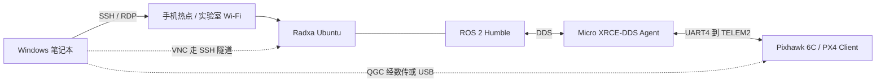

# 操作详解：每一步怎么做、怎么判断做对了

[返回 README 主线](README.md) · [故障排查](故障排查.md) · [实测时间线与验收表](实测过程与验收.md)

这页与 README 的 A1–A5、B1–B6 一一对应。README 是顺序清单；这里解释正常输出、需要等待的地方、可选对照和出问题时的下一步。已有部分环境的读者，可以从每节的检查命令开始，跳过已通过的步骤。



这三条连接可以独立出现故障：笔记本到 Radxa 的网络、QGC 到飞控的 MAVLink、Radxa 到飞控的 DDS 串口。例如 QGC 连接正常而 DDS 断开，应查 UART；关闭手机热点后远程桌面断开，通常先查 Radxa 换到哪个 IP。

## A1–A2：从空卡到第一次 SSH 登录

### 先确认是正在写哪张卡、启动的是哪套系统

- 推荐旧卡留着，用另一张 microSD 装新系统。本文验证的是 Ubuntu Rockchip v2.4.0 的 **ZERO 3 Server** 镜像；不能用 Ubuntu 通用 ARM64 镜像、其他 Radxa 板型的镜像或旧 Debian 的 overlay 命令替换。`5.10.0-1012-rockchip` 是实际启动后记录到的内核，不是所有 Ubuntu 22.04 都用的版本。
- 烧录前后都可用 **Windows PowerShell** 比较磁盘列表。以插拔变化和容量定位目标；不要根据示例中的磁盘编号选择，也不要在磁盘管理里初始化或格式化它。

```powershell
Get-Disk | Select-Object Number,FriendlyName,BusType,Size,PartitionStyle
Get-Volume | Select-Object DriveLetter,FileSystemLabel,FileSystem,Size
Get-ChildItem -LiteralPath 'F:\' -Name
```

将 `F:\` 换成实际盘符。只在该分区能看到 `user-data` 和 `network-config`，且新系统还未启动时，执行 README A1。脚本输出 `DONE`，并在分区备份原文件；它不会启动板子或验证 Wi-Fi 密码。如果脚本在 Windows 报找不到卷，先核对是否选中了含这两个文件的分区，不给 Linux 系统分区强行分配盘符。

### 开机后按「无线 → IP → SSH」查

1. 先让板子获得稳定 5 V 供电，打开已写入的手机热点。首次 cloud-init 可能需要几分钟；手机列表出现新设备就可以查 IP。实验室 Wi-Fi 此时仅记录了凭据，所以它从未出现也不等于首次脚本失败。
2. 若看不到板子，有屏幕时在 **Radxa** 查下面几条。`wlan0` 有局域网地址，说明至少已走到 IP 配置；`cloud-init status` 为 `done` 表示初始化完成。如果未拿 IP，先处理 Wi-Fi，再看 SSH；如果已经连到热点而 Internet 慢，可从本地终端切换到实验室普通密码 Wi-Fi，见[网络恢复](故障排查.md#lab-wifi)。

```bash
ip -br link
ip -br -4 addr
ip route
cloud-init status --long
systemctl is-active ssh
ss -ltn | grep ':22 '
```

3. 在 **Windows** 将 `$BoardIP` 设为本轮 IP。`TcpTestSucceeded : True` 代表端口可达，接着才用 `ssh` 登录；出现 `Permission denied` 时再核对账号与密码。首次登录改掉模板密码。热点或路由器启用客户端隔离时，即使两端都有地址也可能无法互访。

```powershell
$BoardIP = '192.0.2.10'  # 换成当前实际 IP
Test-NetConnection $BoardIP -Port 22
ssh "ubuntu@$BoardIP"
```

## A3：软件装到哪一步了

三段安装并不需要同时跑。先用 Windows 准备并上传整个目录，然后从 **Radxa Ubuntu 终端**逐段运行。`ros2-apt-source...deb` 是 APT 源配置包，`rosdep-data/` 是依赖规则；二者不能代替 Internet 上的 ROS 软件包或 Git 源码。`scp` 若中途失败，补传文件后再续，不先删除板子上的目录。

| 项目 | 检查命令（Radxa） | 通过时怎么看 |
| --- | --- | --- |
| 基础工具、桌面 | `command -v gcc cmake git tigervncserver`；`systemctl is-active radxa-desktop.service` | 找到程序，服务返回 `active` |
| 内存与磁盘 | `free -h`；`swapon --show`；`df -h /var "$HOME"` | 本次新增约 2 GiB swap；已有足够 swap 时脚本不重复创建。需要新建交换文件时，`/var` 至少留 5 GiB，工作空间还需额外容量 |
| ROS 基础层 | `source /opt/ros/humble/setup.bash`；`printenv ROS_DISTRO`；`command -v colcon` | 有 `humble` 和 colcon 路径；这还不证明 PX4 消息包已经编好 |
| 消息包和 Agent | `source ~/ros2_px4_ws/install/setup.bash`；`ros2 pkg prefix px4_msgs`；`command -v MicroXRCEAgent` | 两条路径都应该能找到；`px4_msgs` 指向本次工作空间为宜 |
| 实际编译结果 | `ls -d ~/ros2_px4_ws/{src,build,install,log}`；看原构建终端最后的 Summary | 本次两个包完成且有 `PX4 BUILD READY`；不能把有 `build/` 目录当作完成 |

补充查看准确包版本，便于以后写自己的设备清单：

```bash
dpkg-query -W -f='${Package}\t${Version}\n' \
  xfce4 xrdp tigervnc-standalone-server tigervnc-tools network-manager \
  ros-humble-ros-base python3-colcon-common-extensions python3-rosdep
uname -r
```

若在 SSH 编译，本轮不中途改 Wi-Fi，不另开第二个编译进程。编译百分比卡住时，按[构建故障](故障排查.md#build-issues)判断 CPU、日志和错误；只在失败结束后续跑相应阶段。成功后按 README 附录记录两个 Git 版本，升级 PX4 时重新核对消息版本，别把旧工作空间与新固件混用。

## A4：Wi-Fi 怎么切，切了从哪里找板子

首次启动用 Netplan/networkd；执行 `setup.py network` 后才准备交给 NetworkManager。脚本把旧 Netplan YAML 保存在 `/etc/netplan/before-radxa-*`，并关闭 cloud-init 对网络配置的后续生成。它尽量保留当前远程连接，让新配置在重启后生效。第一次切换建议保留本地键盘和显示器。

| 现场状态 | 应观察到什么 | 本次证据 |
| --- | --- | --- |
| 仅实验室 Wi-Fi 可用时开机 | `radxa-lab` 连接并取得实验室 IP | 实验室连接恢复后已可 SSH；有过短时超时 |
| 已连 `radxa-lab`，再打开手机热点 | 定时器扫描，两次看到热点后尝试 `radxa-phone`；旧 IP 的 SSH 可能断开 | 已通过 |
| 正连 `radxa-phone`，关闭热点 | 自动连回 `radxa-lab`；Windows 换回实验室网络和新 IP | 已通过 |
| 两个网络开机都可见 | 100 优先于 10；启动结果还会受扫描时机影响 | 本次未单独多轮实测 |

在 **Radxa** 查看当前实际连接，而不输出密码：

```bash
nmcli -f NAME,TYPE,DEVICE connection show --active
nmcli -f GENERAL.STATE,GENERAL.CONNECTION,IP4.ADDRESS device show wlan0
systemctl is-enabled radxa-hotspot-prefer.timer
systemctl list-timers radxa-hotspot-prefer.timer
sudo journalctl -b -u radxa-hotspot-prefer.service -n 30 --no-pager
```

如果自动切换后暂时连不上，先从本地读 IP 或从当前网络的设备列表找板子，再在 Windows 重设 `$BoardIP`。改过 Wi-Fi 密码时，不靠重复运行 `setup.py network` 更新：该阶段看到已准备标记后会保留原配置。优先在本地用 `nmtui` 编辑对应配置；需要暂时回到实验室时，可停主动切换定时器并手动激活实验室配置 **（会中断当前 SSH，必须从本地终端执行）**：

```bash
sudo systemctl disable --now radxa-hotspot-prefer.timer
sudo nmcli connection up id radxa-lab ifname wlan0
ip -br -4 addr
```

先确认实验室网络可用，再用 `sudo systemctl enable --now radxa-hotspot-prefer.timer` 恢复策略。若连 `radxa-lab` 都不存在，看[实验室 Wi-Fi 恢复](故障排查.md#lab-wifi)；先检视 Netplan 备份，不要把不同阶段的 YAML 混在一起。

## A5：区分 RDP、VNC 和 SSH 的三种连接

| 在 Windows 使用 | 连接目标 | 需要的密码 |
| --- | --- | --- |
| `ssh` / `scp` | `ubuntu@板子当前IP`，TCP 22 | Ubuntu 用户密码或自己的 SSH 密钥 |
| `mstsc` | 板子当前 IP，默认 TCP 3389；会话选 `Radxa XFCE` | VNC 主密码；此 xrdp 配置把连接转给板子上的 TigerVNC |
| TigerVNC Viewer | 先开 SSH 转发窗口，再连 `127.0.0.1::15901` | 转发窗口是 SSH 密码；Viewer 再填 VNC 主密码 |

虚拟桌面随 `radxa-desktop.service` 启动，板子本机使用 `127.0.0.1:5901`。因此笔记本直接连接板子 IP 的 5901 不通是预期；15901 不通先看 SSH 转发窗口有没有退出或本地端口冲突；15901 通但 Viewer 报错，再回板子查 5901 和桌面日志。RDP 能显示 xrdp 登录框只说明 xrdp 端口能到；它之后还要连本机 VNC 才会看到桌面。

验收时可先在 XFCE 打开一个终端，再断开 RDP、用 VNC 重连确认是同一桌面。测试开机时先正常关机，移除 HDMI，重新上电后重建 SSH 转发窗口；桌面能打开才算本轮无屏验收通过。旧 Debian 的 Xorg 修法和这套 VNC 后端不同，详见[故障篇](故障排查.md)。

## B1–B3：核对设备、参数和串口引脚

### 先用 QGC 留下参数与端口的前后证据

在 QGC 参数页导出修改前与修改后的文件，自己保存。查看固件版本后，在 **QGC → 分析工具 → MAVLink 控制台**读取：

```text
ver all
param show UXRCE_DDS_CFG
param show SER_TEL2_BAUD
param show MAV_0_CONFIG
param show MAV_1_CONFIG
param show MAV_2_CONFIG
param show SENS_TFLOW_CFG
param show SENS_TFMINI_CFG
param show GPS_2_CONFIG
mavlink status
```

`SER_TEL2_BAUD` 暂时不显示，先核对端口是否已分配、固件是否已重启。设置完成后检查 `UXRCE_DDS_CFG=102`（TELEM2）、`SER_TEL2_BAUD=115200`。只有与本例同样把 ThoneFlow 从 TELEM2 迁到空闲 GPS2 才设 `SENS_TFLOW_CFG=202`。已部署的飞控不随手导入别人的整份参数，也不为这次串口配置重刷固件或清参数。

### overlay 已生效，不代表线已经接对

**Radxa** 启用前读取系统与 overlay；启用后检查 `/dev/ttyS4` 是否为字符设备、权限是否为 `root:dialout`、当前用户名是否已取到 `dialout` 组。如果刚加入组，本地终端或 SSH 要退出再登录，`id -nG` 的结果才反映新会话。

```bash
test -c /dev/ttyS4 && echo 'UART device exists'
ls -l /dev/ttyS4
readlink -f /sys/class/tty/ttyS4/device/of_node
id -nG
sudo fuser -v /dev/ttyS4
```

本机对应 `serial@fe680000`。原调试口 `/dev/ttyS1` 不是本方案用的口。系统出现串口后，还要按厂家图认准确**物理编号**：确认 Pin 1 后，与它并排的是 Pin 2；偶数列中 GND/6 是第 3 个、RX/16 是第 8 个、TX/18 是第 9 个。接飞控时接 `TX→RX`、`RX←TX`、`GND↔GND`，只需三线。3.3 V 是 UART 信号电平，5 V 是 Radxa USB-C 电源输入，不能互相代替。杜邦接触不稳时断开两边电源后检查端子和焊点；列出设备与本机回环通过也不能证明飞控端线束已经连好。

### 如果要退回原光流接法

先比对**自己的**原始参数备份。本例原始 `UXRCE_DDS_CFG=0`、`SENS_TFLOW_CFG=102`；如果确实要回到本例的原方案，只恢复与这次迁移有关、且已核对过的值。先停止 Radxa Agent；断电拆掉 Radxa→TELEM2 三线，光流从 GPS2 恢复到原来 TELEM2，再上电读 `thoneflow status` 和新光流消息。波特率和其他项目按原始备份恢复，不用把本文的 115200 当作原来的光流参数。

## B4–B5：从 Agent 进程到应用层双向通信

| 看到的输出 | 它证明了什么 | 若没达到，先看哪里 |
| --- | --- | --- |
| Radxa `enabled` | 服务配置为开机加载 | `systemctl is-enabled radxa-px4-agent.service` |
| Radxa `active (running)` | Agent 进程在运行 | 本次开机日志、用户权限与串口路径 |
| PX4 `Running, connected` | Client 与 Agent 建立了 XRCE 会话 | 两端速率、端口占用、TX/RX 与 GND；`timesync converged` 辅助观察 |
| ROS 图里有 `/fmu/out/...` | 发现了话题，未必收到数据 | `ros2 topic info -v`，核对实际 topic、发布者和 QoS |
| `echo --once` 收到新时间戳 | 本轮 PX4 → Radxa 应用数据通过 | 运行下面命令实测，不能只看历史打印 |
| 收到 `command=401, result=0` | 本次请求与回执都过链路 | 核对服务名、消息类型、目标 ID；预检是否通过另看状态位 |

**Radxa**：下面在终端已加载两层 ROS 环境后执行。`ROS_DOMAIN_ID` 若未设置，通常使用默认域 `0`；本例飞控导出也是 `UXRCE_DDS_DOM_ID=0`。若换过域或命名空间，先用 QGC 的 `param show UXRCE_DDS_DOM_ID` 和 ROS 列表对照，不盲目改参数。

```bash
printenv ROS_DISTRO
printf 'ROS_DOMAIN_ID=%s\n' "${ROS_DOMAIN_ID:-0}"
ros2 topic list -t
ros2 topic info -v /fmu/out/vehicle_status_v1
ros2 service type /fmu/vehicle_command
ros2 interface show px4_msgs/srv/VehicleCommand
```

`/fmu/out/vehicle_status_v1` 是这次 PX4 版本实际出现的名字。对 PX4 状态使用 `--qos-reliability best_effort`，避免用要求更高可靠性的订阅去订一个 best-effort 发布者。先用 README B5 收一条消息，必要时再收第二条确认时间戳更新。ROS `timeout` 退出码 124 只说明这次等候超时；要区分话题不存在、找到话题但未收帧，以及服务请求发出没得到回执。

### 为什么开终端和开机自启互不依赖

交互式 Bash 的 `~/.bashrc` 是为了让你每次开终端就能用 ROS 命令；systemd 不靠它。服务的 `ExecStart` 独立 `source` ROS 基础环境和工作空间，再启动 Agent。飞控则由 PX4 读取保存后的端口与波特率来启动 Client。`After=network.target` 是服务的启动排序，并不要求 Wi-Fi 或 Internet 接通；真正握手走 UART。`Restart=always` 只在 Agent 进程退出后重启它，不能把仍在运行但未握手的状态当作自动修好。

```bash
systemctl cat radxa-px4-agent.service
systemctl show radxa-px4-agent.service -p ActiveState -p MainPID -p NRestarts
journalctl -b -u radxa-px4-agent.service --no-pager -n 50
```

平时用上面这些查询就能看进度，不再起第二份 Agent。若刚编辑过服务模板，先看实际服务内容和正确路径，再执行 `sudo systemctl daemon-reload`；更改后的服务要经 `sudo systemctl restart radxa-px4-agent.service` 才重新运行。**复验自启时不要执行 `restart`**，否则就变成了人工恢复。

## B6：怎么做一次能说明问题的冷启动

- Radxa 单独 `reboot` 只能证明它重启后能否找回仍在运行的飞控。真正双端冷启动，先正常关机，再让双方失去全部供电，尤其留意持续给飞控供电的 USB。
- 每一轮只改变一个条件。先固定“飞控先上电、Radxa 后上电”做基线。反过来上电理论上也可握手，但应另开一轮单独记录；不要把基线结果写成两种顺序都已实测。
- 验收顺序：**本次启动的 Agent 日志 → PX4 Client connected → 一条新状态 → 一次 401 回执**。不用打开 QGC 才能连接，但 QGC 可作观察端；若用 USB 查状态，先记录它何时接入，避免改变断电条件。若任一步失败，记录后再排查，不在同一轮交替拔线和重启。

[实测过程与验收](实测过程与验收.md)里有可直接复制的测试表。它也列了传感器、网络和无屏桌面的各自通过条件，避免把一项通过写成整机通过。

资料：[Ubuntu Jammy / Humble 安装](https://docs.ros.org/en/humble/Installation/Ubuntu-Install-Debs.html) · [Humble QoS](https://docs.ros.org/en/humble/Concepts/Intermediate/About-Quality-of-Service-Settings.html) · [NetworkManager 连接设置](https://networkmanager.dev/docs/api/latest/settings-connection.html) · [PX4 1.17 uXRCE-DDS](https://docs.px4.io/v1.17/en/middleware/uxrce_dds) · [Radxa 排针](https://docs.radxa.com/en/zero/zero3/hardware-design/hardware-interface) · [Pixhawk 6C 端口](https://docs.holybro.com/autopilot/pixhawk-6c/pixhawk-6c-ports)。
